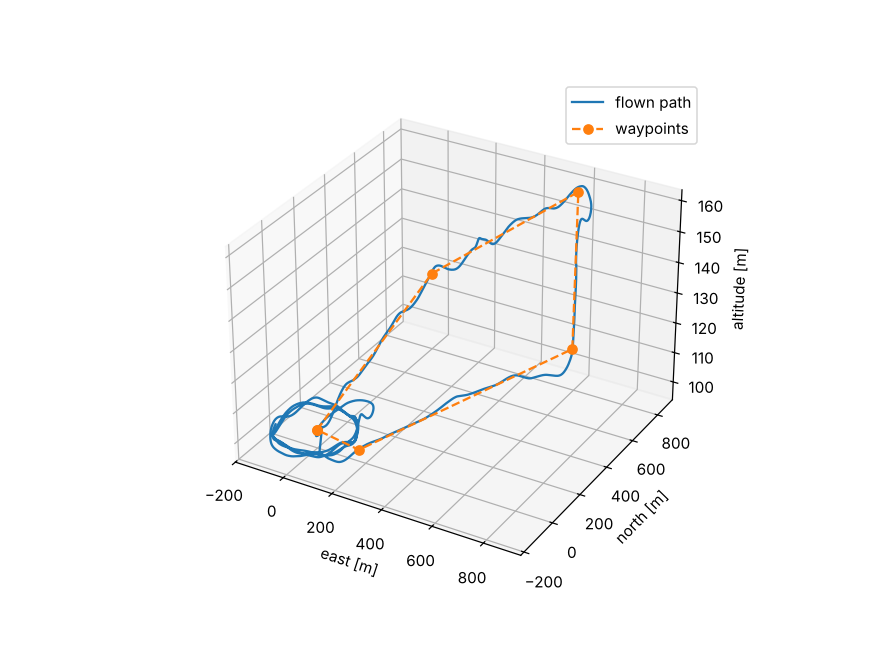
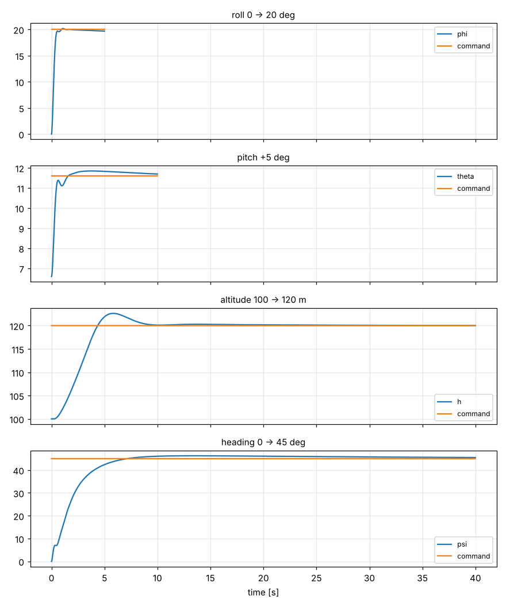
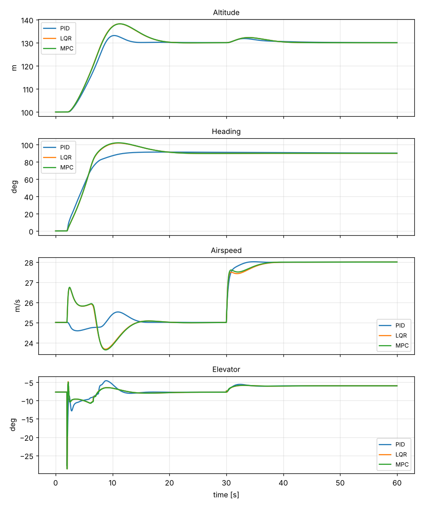

# UAV Flight Dynamics & Autonomy

A Python flight-dynamics and autonomy stack for a small fixed-wing UAV, built from first principles with NumPy and SciPy:

- **2D simulator** (longitudinal, 3DOF) that runs in real time, at any multiple of real time, or unthrottled
- **PID control loops** for roll, pitch, altitude and heading (plus airspeed and sideslip)
- **Full nonlinear 3D 6DOF model**
  - translational equations for 6 states (NED position + body velocity)
  - rotational dynamics for 3 angular rates + 3 orientation states
  - aerodynamic forces and moments built from **29 stability derivatives** (with stall blending)
  - **Euler-angle and quaternion** attitude formulations, switchable per model
- **Trim solver** for straight, climbing and coordinated-turn flight, plus numerical linearisation and mode analysis
- **LQR** (with integral action) and **constrained linear MPC** controllers
- **3D waypoint navigation** with vector-field path following, half-plane switching and a loiter orbit
- **Noise-based sensor simulation** (gyro, accelerometer, magnetometer, barometer, pitot, GPS) and a complementary-filter state estimator
- Wind with steady and gust components
- 82 unit and closed-loop tests, and five example scripts



## Install

```bash
git clone https://github.com/Ertugrul5334/uav-flight-dynamics-autonomy.git
cd uav-flight-dynamics-autonomy
pip install -e ".[dev]"     # numpy, scipy, + pytest and matplotlib for tests/plots
pytest -q
```

## Quick start

```python
import numpy as np
from uavsim import SixDOF, Simulation, trim
from uavsim.control import Autopilot, Commands

model = SixDOF(attitude="quaternion")           # or attitude="euler"
tr = trim(model, Va=25.0, altitude=100.0)       # steady level flight
ap = Autopilot(dt=0.01, trim_delta=tr.delta, trim_theta=tr.theta)

sim = Simulation(model, tr.x, dt=0.01)
cmd = Commands(Va=25.0, h=130.0, chi=np.radians(90))
log = sim.run(60.0, lambda t, s: ap.update(cmd, s.state), realtime_factor=None)  # 1.0 = real time
print(sim.state.h, np.degrees(sim.state.chi), f"{log.speedup:.0f}x real time")
```

## Examples

Run from the `examples/` directory; figures are written to `examples/output/` when matplotlib is installed.

| Script | What it shows |
| --- | --- |
| `01_sim2d_realtime.py` | 2D sim with cascaded PID, unthrottled vs. paced (`--rt 1` for real time) |
| `02_pid_autopilot.py` | Roll, pitch, altitude and heading loop step responses on the 6DOF model |
| `03_trim_and_linearize.py` | Trim in five flight conditions; phugoid, short-period, roll, Dutch-roll and spiral modes |
| `04_lqr_vs_mpc.py` | PID vs. LQR vs. MPC on a combined climb, turn and speed change |
| `05_waypoint_mission.py` | 3D waypoint mission in gusty wind on simulated sensors and the estimator |

### Results from the example scripts

PID loop step responses on the 6DOF model (100 Hz control, `02_pid_autopilot.py`):

| Loop | Step | Rise time | Settling time (5 %) | Overshoot |
| --- | --- | --- | --- | --- |
| Roll | 0 → 20° | 0.31 s | 0.44 s | 0.8 % |
| Pitch | +5° | 0.38 s | 4.3 s | 5.1 % |
| Altitude | 100 → 120 m | 2.9 s | 7.9 s | 13 % |
| Heading | 0 → 45° | 4.0 s | 5.2 s | 2.8 % |



Other figures from the same scripts:

- 2D simulator: about 60–85× real time unthrottled on a laptop-class CPU; the 6DOF model with full autopilot runs at about 10–15×.
- Trim at 25 m/s level: α = 6.6°, elevator −7.7°, throttle 0.67. Short period ω<sub>n</sub> = 3.8 rad/s (ζ = 0.35), phugoid ω<sub>n</sub> = 0.51 rad/s (ζ = 0.46), Dutch roll ω<sub>n</sub> = 9.7 rad/s (ζ = 0.39), and a very slow, slightly divergent spiral mode, which is typical of this airframe.
- Waypoint mission in 4–5 m/s wind with gusts, flown on the estimator: all waypoints reached, estimation RMS error about 1.5° in roll and pitch, 2° in heading, 0.3 m in altitude.



LQR and MPC share the same linear model and weights, so they agree closely whenever the actuator limits are not active; MPC enforces the limits explicitly inside its optimisation (visible in the elevator trace), whereas LQR simply clips its output.

## How it works

### 6DOF equations of motion (`uavsim/dynamics.py`)

State (quaternion mode, 13 states): `[pn, pe, pd, u, v, w, e0, e1, e2, e3, p, q, r]`; Euler mode replaces the quaternion with `[phi, theta, psi]`.

```
translational   [pn pe pd]' = R(att) [u v w]
                [u v w]'    = -ω × v + F/m
rotational      J ω'        = M − ω × Jω
                [φ θ ψ]'    = W(φ, θ) ω                 (Euler)
                q'          = ½ Ω(ω) q + k(1 − |q|²) q  (quaternion, with norm stabilisation)
```

Integrated with fixed-step RK4. The quaternion form flies straight through θ = ±90° where the Euler form is singular (there is a test for this).

### Aerodynamics (`uavsim/aerodynamics.py`, `uavsim/params.py`)

Lift, drag, side force and roll/pitch/yaw moments are linear in α, β, the non-dimensional rates and the control surfaces, using the Aerosonde-class coefficient set from Beard & McLain, *Small Unmanned Aircraft* (2012). Lift is blended to a flat-plate model past stall, drag follows a parabolic polar, and thrust comes from a simple momentum-theory propeller model. Density follows the ISA atmosphere.

### Trim and linearisation (`uavsim/trim.py`)

Solves for `[α, β, φ, θ, δe, δa, δr, δt]` given airspeed, flight-path angle and turn radius, with zero sideslip, as a bounded nonlinear least-squares problem (residuals around 1e-15). `linearize` returns central-difference Jacobians A (12×12) and B (12×4) of the Euler model.

### Control (`uavsim/control/`)

- `PID`: derivative on measurement (or a supplied gyro rate), dirty-derivative filter, output limits with conditional-integration anti-windup, and angle wrapping for heading.
- `Autopilot`: successive loop closure. Heading/course → roll → aileron, altitude → pitch → elevator, airspeed → throttle, sideslip → rudder.
- `LQRController`: continuous-time LQR on the 10-state linear model, augmented with integrators on the altitude, airspeed and heading errors (LQI). Weights from Bryson's rule.
- `MPCController`: the same augmented model discretised with a zero-order hold, condensed into a box-constrained QP over a 30-step horizon, solved with warm-started L-BFGS-B, using the discrete LQR cost-to-go as terminal cost.

### Guidance, sensors and estimation

- `WaypointNavigator`: straight-line vector-field course law, altitude interpolated along each leg, half-plane waypoint switching, loiter orbit at the end.
- `SensorSuite`: gyros (white noise + bias random walk), accelerometers (specific force), 3-axis magnetometer, static and differential pressure, and GPS with a Gauss–Markov position error, each at its own rate (IMU 100 Hz, GPS 5 Hz, …).
- `ComplementaryEstimator`: gyro/accelerometer complementary filter for roll and pitch (with centripetal compensation), tilt-compensated magnetometer heading, baro altitude, pitot airspeed, and GPS position and course dead-reckoned between fixes.

## Project layout

```
uavsim/
  rotations.py      Euler / DCM / quaternion maths and kinematics
  atmosphere.py     ISA model
  params.py         airframe parameters and stability derivatives
  aerodynamics.py   aero + propulsion forces and moments
  dynamics.py       6DOF model (Euler or quaternion), RK4
  sim2d.py          2D longitudinal simulator with PID loops
  simulation.py     real-time / faster-than-real-time runner, wind, logging
  trim.py           trim solver, linearisation, modes
  control/          PID, autopilot, LQR, MPC
  guidance.py       3D waypoint navigation and loiter
  sensors.py        noisy sensor models
  estimation.py     complementary-filter state estimator
  metrics.py        step-response metrics
tests/              82 tests (pytest)
examples/           runnable demos
```

## References

- R. W. Beard and T. W. McLain, *Small Unmanned Aircraft: Theory and Practice*, Princeton University Press, 2012.
- B. L. Stevens, F. L. Lewis and E. N. Johnson, *Aircraft Control and Simulation*, 3rd ed., Wiley, 2015.

## License

MIT
